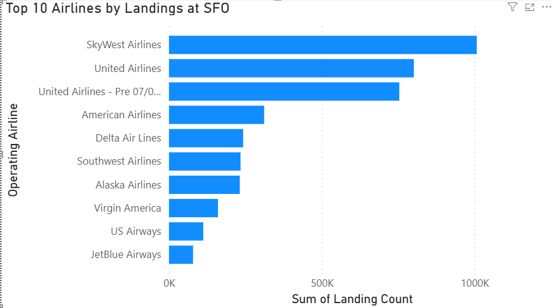
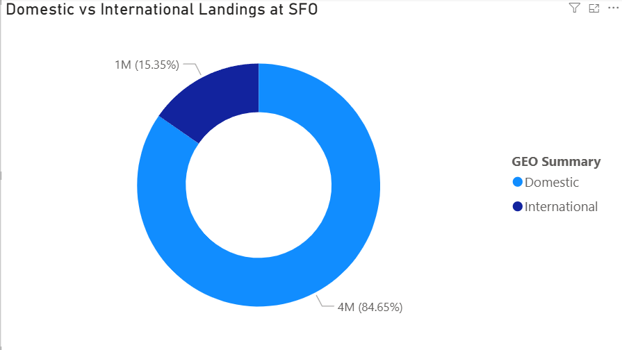
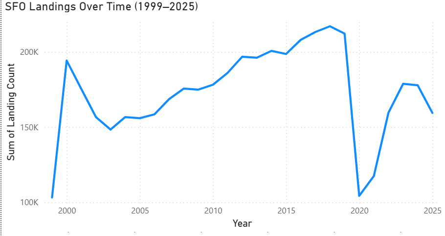
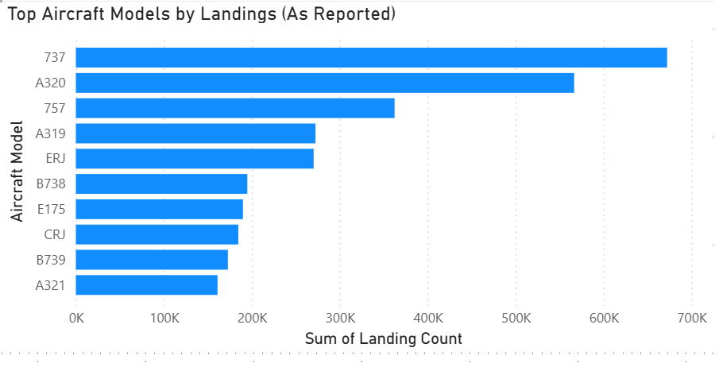

# SFO Airline Operations & Fleet Mix Analysis

## Overview
This project analyzes airline landing activity at **San Francisco International Airport (SFO)** using historical operational data spanning **July 1999 through October 2025**.

The analysis focuses on understanding:
- airline concentration at SFO  
- domestic vs. international traffic mix  
- long-term operational trends  
- aircraft fleet composition  

The project is intentionally scoped as a **Power BI–focused operational analysis**, emphasizing clarity, domain awareness, and realistic interpretation of aviation data.

---

## Dataset
**Source:** Air Traffic Landings Statistics (SFO)

### Grain
Each row represents **aggregated landing activity** by:
- Airline  
- Time period (monthly)  
- Geographic classification  
- Aircraft characteristics  

### Key Columns Used
- Activity Period Start Date  
- Operating Airline  
- Operating Airline IATA Code  
- GEO Summary (Domestic / International)  
- GEO Region  
- Landing Aircraft Type  
- Aircraft Body Type  
- Aircraft Manufacturer  
- Aircraft Model  
- Landing Count  

### Data Structure Notes
- The dataset is **pre-aggregated** and does not contain flight-level records.  
- There is **no explicit primary key**; the table functions as a **fact table**, with *Landing Count* treated as the primary operational metric.  
- Airline and aircraft labels reflect the level of detail available at the time of reporting.

---

## Analytical Focus
This project answers four core operational questions:

1. Which airlines operate the most landings at SFO?  
2. How has landing activity at SFO changed over time?  
3. What share of SFO traffic is domestic vs. international?  
4. Which aircraft models account for the highest landing volumes?  

The scope is deliberately constrained to avoid over-engineering and to maintain analytical clarity.

---

## Dashboard Visuals

### Top 10 Airlines by Landings at SFO

### Domestic vs International Landings at SFO

### SFO Landings Over Time (1999–2025)

### Top Aircraft Models by Landings (As Reported)

---

## Key Insights
- **Airline concentration:** SFO operations are dominated by a small number of carriers, led by United due to hub operations. Regional airlines (e.g., SkyWest, Horizon) play a significant feeder role.
- **International gateway:** SFO exhibits a materially higher share of international landings than most U.S. airports, reinforcing its role as a global hub.
- **Operational volatility:** Landing activity shows long-term growth punctuated by major disruptions, most notably the sharp decline during the COVID-19 period.
- **Fleet mix:** High-frequency operations are driven primarily by narrow-body aircraft, while wide-body aircraft contribute fewer but strategically important international landings.
- **Data nuance:** Aircraft model and airline labels vary in specificity over time; earlier records often use more generic classifications, while later records distinguish specific variants (e.g., NG and MAX aircraft).

---

## Tools Used
- **Power BI Desktop** — data modeling and visualization  
- **Power Query** — data preparation and column selection  

---

## Skills Demonstrated
- Operational data analysis  
- Dimensional thinking (facts vs. dimensions)  
- Time-series trend analysis  
- Domain-aware interpretation of aviation data  
- BI dashboard design with scoped analytical questions  
- Avoiding misleading aggregation and assumptions  

---

## Notes & Limitations
- Airline mergers and subsidiaries (e.g., SkyWest, Horizon, historical carriers) are treated as **operating airlines at the time of landing**, not retroactively consolidated under current parent brands.
- Aircraft model classifications are analyzed **as reported** to preserve historical accuracy.

---

## Project Status
This project is considered **complete** as a focused operational analysis.

### Potential Future Extensions
- Manufacturer-level aggregation (Boeing vs. Airbus)  
- Passenger vs. cargo segmentation  
- Route-level analysis if flight-level data becomes available  
